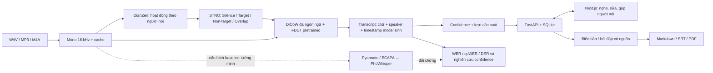

# Kiến trúc Meeting Minutes ASR

**Luồng mặc định của CLI, API và Docker là DiariZen + DiCoW** (`configs/default.yaml`, tương đương `configs/dicow-author.yaml`). Model nhận audio đầy đủ và STNO cho từng target, dùng FDDT đã huấn luyện của checkpoint tác giả; không cắt audio để đưa vào PhoWhisper. DiariZen được giải phóng trước khi nạp DiCoW; decode từng target để giảm VRAM. Đây là tích hợp pretrained, chưa fine-tune lại.

Runtime tác giả tách khỏi ứng dụng: local ở `.cache/dicow`, Docker ở `/opt/dicow`. Image CPU/GPU tự cài code tác giả và dependency đã pin, dùng cùng engine; trọng số tải/cache ở lần inference đầu. `MEETING_DICOW_PYTHON`, `MEETING_DICOW_UPSTREAM_DIR`, `MEETING_DICOW_RUNTIME_MANIFEST` trỏ tới runtime đóng gói trong image.

M1–M5 chạy theo stage, giải phóng model/GPU giữa các bước. Cache phụ thuộc audio, cấu hình upstream, implementation và phiên bản thư viện. Dự đoán gốc được giữ riêng với bản sửa. Một worker xử lý tuần tự; SQLite kiểm tra revision khi sửa hoặc lưu câu trả lời. Khởi động lại dùng stage đã cache.

RTTM DiariZen dự đoán gốc dùng để chấm DER; transcript dùng timestamp DiCoW sinh. Cache joint M2/M3 giữ cùng diarization, transcript, raw output và provenance; model revision, oracle RTTM hoặc runtime manifest thay đổi sẽ làm mất hiệu lực cache.

**Baseline chỉ phục vụ thí nghiệm/báo cáo:** `configs/baseline-phowhisper.yaml` chọn Pyannote → audio cuts → PhoWhisper; `configs/improved-ecapa.yaml` chọn ECAPA với ngữ cảnh ASR cải thiện. Cài extra `inference` trong môi trường local riêng khi cần tái chạy. Nối mảnh cùng speaker trước ASR chỉ thuộc baseline và không thay RTTM chấm điểm. Với dữ liệu mô phỏng, speech RTTM dùng để chấm DER/overlap, utterance RTTM dùng để chạy ASR oracle, lời tham chiếu theo utterance dùng để chấm WER/RQ3. Nhãn máy và nhãn người nghe có trạng thái/provenance riêng.

Biên bản và hỏi đáp dùng transcript đã sửa, kiểm tra ID nguồn và lấy thời gian/người nói từ transcript. Đổi nội dung làm đầu ra cũ stale. ID hợp lệ chưa chứng minh một ý được nguồn hỗ trợ về nghĩa; nghiệm thu thực tế và review semantic nằm trong [ACCEPTANCE.md](ACCEPTANCE.md).

Compose chạy website và API trong cùng mạng; trình duyệt dùng `/api` qua proxy. Image web dùng Next standalone và user không phải root. API có target CPU và GPU riêng. Ứng dụng hiện phục vụ demo local, một worker; triển khai nhiều người dùng cần thiết kế thêm ownership, xác thực và điều phối worker.

Confidence của DiCoW thiếu token log probability và cluster margin; các tín hiệu này để null, điểm chưa được hiệu chỉnh. RQ3 cần đánh giá lại trên dữ liệu dev/test độc lập; không so điểm màu của hai hệ như cùng thang đo. Benchmark DiCoW lấy device và peak CUDA allocated từ process inference, không lấy VRAM của process API. Kết quả chất lượng và giới hạn dữ liệu nằm trong [DICOW_COMPARISON.md](DICOW_COMPARISON.md).
