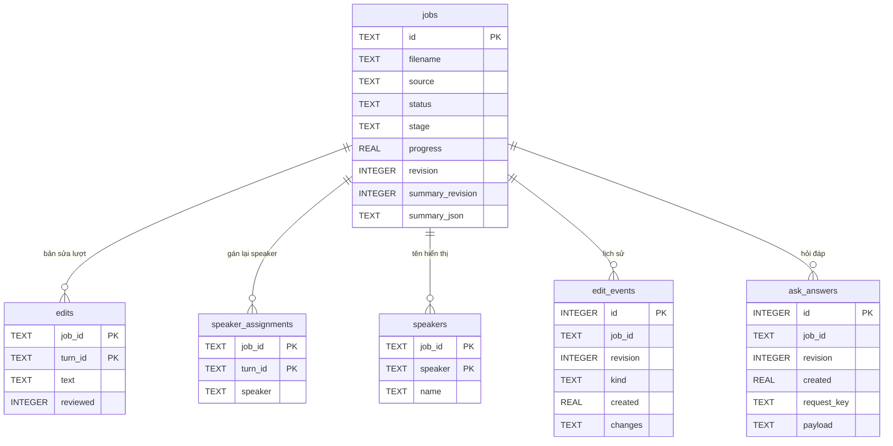

# Lưu trữ dữ liệu và API

Nguồn: [jobs.py](../src/meeting_asr/jobs.py), [api.py](../src/meeting_asr/api.py),
[models.py](../src/meeting_asr/models.py). Xem [kiến trúc](design/README.md) và [triển khai](DEPLOYMENT.md).

## Mô hình lưu trữ

- Mặc định: `results/jobs/jobs.sqlite3`; SQLite dùng WAL, migration khi khởi tạo JobStore.
- Audio upload: `results/jobs/{job_id}/audio.<đuôi>`; artifact ở `{job_id}/artifacts/`.
- Transcript/turn gốc nằm trong file JSON, không có bảng `transcripts` hoặc `turns` riêng.
- ERD dưới đây chỉ biểu diễn quan hệ logic qua `job_id`; DDL hiện không khai báo FOREIGN KEY.

ERD lược bớt cột của `jobs`; bảng sau ghi các nhóm dữ liệu thực lưu.

| Nơi lưu | Khóa/trường chính | Ý nghĩa |
| --- | --- | --- |
| `jobs` | `id`; `filename`, `source`, `title` | Job, tên audio, đường dẫn audio và tiêu đề |
| `jobs` | `status`, `stage`, `progress`, `error`, `kind` | Hàng đợi/xử lý; `kind`: `pipeline` hoặc `summary` |
| `jobs` | `created`, `started`, `finished`, `duration` | Thời điểm Unix tính bằng giây; thời lượng audio bằng giây |
| `jobs` | `revision`, `summary_revision`, `finalized_revision` | Phiên bản bản sửa, biên bản và bản đã chốt |
| `jobs` | `summary_json`, `summary_template`, `summary_error` | Biên bản tạo lại dạng JSON trong TEXT, mẫu và lỗi |
| `jobs` | `participants`, `action_state` | JSON trong TEXT: danh sách tên; sửa owner/deadline/done theo index action |
| `edits` | PK ghép (`job_id`, `turn_id`); `text`, `reviewed` | Text thay thế có thể NULL; trạng thái reviewed lưu 0/1 |
| `speaker_assignments` | PK ghép (`job_id`, `turn_id`); `speaker` | Speaker ID thay thế của lượt |
| `speakers` | PK ghép (`job_id`, `speaker`); `name` | Tên hiển thị theo speaker ID của job |
| `edit_events` | `id`; `job_id`, `revision`, `kind`, `created`, `changes` | Lịch sử sửa/gộp; `changes` là JSON trong TEXT |
| `ask_answers` | `id`; UNIQUE (`job_id`, `request_key`) | Revision, thời điểm và payload JSON: question, status, answer_points có nguồn |
| File `transcript.json` | `audio_id`, `utterances`, `config_hash` | Transcript ASR gốc, timestamp/speaker và tín hiệu model |
| File `minutes.json` | `turns`, `summary_points`, `decisions`, `action_items` | Turn gốc, confidence/flags và biên bản nếu bật LLM |
| File RTTM/JSON khác | `diarization.rttm`, `diarsignals.json`, `run.json`, `summary_status.json` | Speaker timeline, tín hiệu, provenance và trạng thái tóm tắt |

- API `/result` ghép artifact gốc với SQLite để trả `original`, `edited`, `revision`, `summary_stale`.
- Sửa text/speaker tăng revision và làm biên bản lệch revision thành stale; chỉ đánh dấu reviewed giữ biên bản hiện tại.
- Câu trả lời có `stale` khi revision lưu khác revision job; lưu câu trả lời cũng kiểm tra revision.
- Action state bị xóa khi tạo lại biên bản; không phải bảng action riêng.

## Danh mục API

Tất cả endpoint nghiệp vụ nằm trong `api.py`; `{job_id}` là ID job.

| Method | Path | Mục đích |
| --- | --- | --- |
| GET | `/api/health` | Trạng thái server, cờ LLM/Ask và engine/model/backend |
| GET | `/api/jobs` | Tối đa 50 job mới nhất, overview và ETA nếu có |
| POST | `/api/jobs` | Upload multipart trường `file`, tạo job; trả 202 và `job_id` |
| GET | `/api/jobs/{job_id}` | Trạng thái, revision, metadata và ETA |
| PATCH | `/api/jobs/{job_id}` | Sửa `title`, `participants`, `finalized` |
| GET | `/api/jobs/{job_id}/result` | Kết quả gốc, bản sửa, nguồn và trạng thái biên bản |
| GET | `/api/jobs/{job_id}/audio` | Đọc audio upload |
| PATCH | `/api/jobs/{job_id}/turns/{turn_id}` | Sửa `text`, `speaker_id`, `speaker_name`, `reviewed`; hỗ trợ `expected_revision` |
| POST | `/api/jobs/{job_id}/speakers/merge` | Gộp `source_speaker` vào `target_speaker`, bắt buộc `expected_revision` |
| GET | `/api/jobs/{job_id}/history` | Tối đa 100 thay đổi mới nhất |
| PATCH | `/api/jobs/{job_id}/actions/{index}` | Sửa `speaker`, `deadline`, `done` của action item |
| POST | `/api/jobs/{job_id}/retry` | Xếp lại job failed; trả 202 |
| POST | `/api/jobs/{job_id}/summary` | Tạo lại biên bản từ bản sửa; mẫu `project`, `standup`, `customer`; trả 202 |
| GET | `/api/jobs/{job_id}/questions` | Tối đa 20 câu hỏi/câu trả lời gần nhất và cờ stale |
| POST | `/api/jobs/{job_id}/questions` | Gửi `question`, `expected_revision`; trả lời có nguồn khi LLM bật |
| GET | `/api/jobs/{job_id}/export?fmt=md` | Export bản sửa; `fmt`: `md` (mặc định), `srt`, `pdf` |

| Tình huống | HTTP status |
| --- | --- |
| Upload rỗng / format export không hợp lệ | 400 |
| Không có job/turn/action | 404 |
| Revision conflict, kết quả chưa sẵn sàng, điều kiện retry/LLM chưa đạt | 409 |
| Upload quá 200 MiB / đuôi không phải WAV, MP3, M4A | 413 / 415 |
| Body không hợp lệ hoặc thao tác sửa không hợp lệ | 422 |
| Không tạo được câu trả lời LLM hợp lệ | 502 |

FastAPI phục vụ đầy đủ schema OpenAPI tại `/openapi.json`, Swagger UI tại `/docs`
và ReDoc tại `/redoc` trên API service. Compose chỉ proxy `/api` qua web;
ba đường dẫn tài liệu trên không được web proxy, không dùng `/api/docs`.
