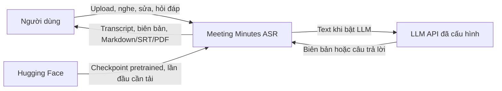
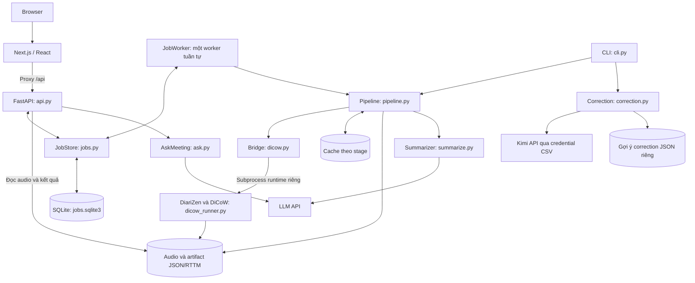

# Kiến trúc phần mềm

Tài liệu rút gọn cho đồ án hệ thống biên bản họp tiếng Việt.
Chi tiết luồng và giới hạn xem [ARCHITECTURE.md](ARCHITECTURE.md).
Lưu trữ/API: [DATABASE_API.md](DATABASE_API.md); cách chạy: [DEPLOYMENT.md](DEPLOYMENT.md).

## Ngữ cảnh hệ thống

- Đầu vào: WAV/MP3/M4A; người dùng kiểm tra lại chữ và người nói bằng audio.
- Bản demo chạy local; chưa có đăng nhập, ownership hay phân quyền nhiều người dùng.
- LLM mặc định tắt; chất lượng model cần đánh giá riêng, không suy từ tests phần mềm.

## Các thành phần

`JobWorker` chạy trong process API, dùng FileLock để tránh hai worker cùng job store.
Runtime tác giả nằm ở `.cache/dicow` khi chạy local, `/opt/dicow` trong Docker.

## Pipeline và đầu ra

| Bước | Xử lý thật trong repo | Đầu ra chính |
| --- | --- | --- |
| M1 – preprocessing | FFmpeg giải mã, mono float32 16 kHz, normalization và cache | AudioBundle, cache preprocessing |
| M2 – diarization | DiariZen dự đoán speaker activity; chuyển thành STNO cho target speaker | `diarization.rttm`, `diarsignals.json` |
| M3 – ASR | DiCoW đa ngôn ngữ dùng audio đầy đủ và STNO/FDDT pretrained; decode từng target | `transcript.json`, `dicow-author-output.json`, `dicow-provenance.json` |
| M4 – postprocess | Gộp utterance thành turn theo cấu hình | Các turn có ID, speaker, timestamp và text |
| M5 – confidence | Tính điểm và gắn cờ lượt cần nghe soát | Confidence, flag và lý do trong `minutes.json` |
| M6 – LLM minutes, tùy chọn | Tóm tắt, quyết định, action item có `source_turn_ids` | `minutes.json`, `summary_status.json` |
| Soát sửa qua API/web | Lưu text, speaker và trạng thái reviewed theo revision | SQLite; giữ artifact gốc |
| LLM correction qua CLI riêng | `correct-transcript` tạo patch ngắn, kiểm tra nguồn và phạm vi sửa | JSON `suggestions_only`, cần người review |
| Hỏi đáp qua API/web | Retrieval trên transcript đã sửa, kiểm tra ID dẫn chứng | Câu trả lời và lịch sử trong SQLite |

- M2/M3 DiCoW dùng cache chung; RTTM dự đoán gốc khác timestamp do ASR sinh.
- `run.json` lưu cấu hình, provenance và thời gian stage; cache phụ thuộc input/config/runtime.
- Đổi nội dung hoặc speaker làm biên bản cũ stale; tạo lại dùng transcript đã sửa.
- Backend kiểm tra ID nguồn và lấy mốc audio từ transcript; chưa chứng minh nội dung đúng nghĩa.
- Correction chưa tự áp dụng vào transcript và chưa có luồng chấp nhận gợi ý trên web.

## Tech stack

| Thành phần | Công nghệ trong repo |
| --- | --- |
| App/CLI | Python 3.11–3.12, `uv`, YAML; image dùng Python 3.12 |
| API và lưu trữ | FastAPI, Uvicorn, Pydantic, SQLite/WAL, FileLock |
| Web | Next.js 16.3.6, React 19.3.0, TypeScript, Tailwind CSS 4 |
| Audio | FFmpeg/ffprobe, NumPy, SciPy, pyloudnorm |
| Inference chính | PyTorch/Torchaudio, runtime DiCoW tác giả được pin riêng |
| Model mặc định | `BUT-FIT/DiCoW_v3_MLC`, `BUT-FIT/diarizen-wavlm-large-s80-md`, WeSpeaker embedding |
| LLM | Adapter HTTP tương thích OpenAI hoặc Claude; mặc định model `gemini-3-flash`, LLM tắt |
| Export | Markdown, SRT; ReportLab và Unicode TTF cho PDF |
| Kiểm thử/triển khai | pytest, Ruff, Playwright; Docker Compose CPU/GPU, Next standalone |

## Quyết định thiết kế

| Quyết định | Lý do/ngữ cảnh |
| --- | --- |
| DiariZen + DiCoW là luồng chính | Theo hướng nghiên cứu transcript theo người nói và overlap đã chốt, xem [README](../README.md) và [ARCHITECTURE.md](ARCHITECTURE.md). |
| Dùng checkpoint MLC pretrained | Có checkpoint đa ngôn ngữ; tích hợp inference, chưa fine-tune hoặc tái lập toàn benchmark paper. |
| Giữ Pyannote/ECAPA + PhoWhisper | Là baseline đối chứng tường minh, không phải cấu hình mặc định. |
| Tách runtime tác giả | Giữ dependency/pin riêng khỏi môi trường app; xem [DICOW.md](DICOW.md). |
| Giải phóng diarizer, decode tuần tự | Giảm nhu cầu VRAM giữa hai model. |
| Cache theo stage và provenance | Dùng lại stage phù hợp khi chạy lại, tránh tái dùng kết quả khi upstream đổi. |
| SQLite và một worker | Phù hợp demo local; worker xếp lại job đang chạy sau restart. |
| Artifact gốc + bản sửa theo revision | Giữ output model, phát hiện sửa đồng thời, nhận biết đầu ra LLM stale. |
| Dẫn chứng bằng turn ID | Backend đối chiếu nguồn thật thay vì nhận timestamp do LLM tự tạo. |

Confidence DiCoW thiếu token log probability và cluster margin, để `null`, chưa calibration.
TODO: nghiệm thu chất lượng và công nghe sửa trên bộ họp tiếng Việt có nhãn đã soát;
xem [kế hoạch đánh giá](https://github.com/loanhviet/meeting-asr/blob/0b641e4/document/GENERAL_MEETING_PLAN_2026-10-26.md).
