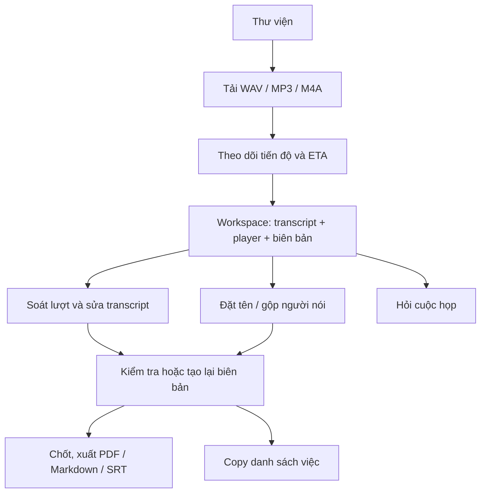

# Thiết kế giao diện

Tài liệu tóm tắt giao diện Next.js trong `web/`; thiết kế tham chiếu: [web/design/README.md](../web/design/README.md). Hướng dẫn thao tác: [USER_MANUAL.md](USER_MANUAL.md).

## Màn hình

| Màn hình | Mục đích | Thành phần chính |
|---|---|---|
| Thư viện cuộc họp | Tìm/lọc và mở job; tải bản ghi mới; theo dõi trạng thái | Library, ô tìm kiếm/bộ lọc, thẻ job, upload dialog, thông báo hoàn tất |
| Workspace | Xem biên bản và điều hướng giữa các nội dung cuộc họp | Workspace, tiêu đề, Transcript, Minutes, Player, menu export, Hỏi cuộc họp |
| Người nói | Đặt tên speaker, nghe ví dụ và gộp nhóm | SpeakersStep, thẻ speaker, audio player |
| Soát transcript | Xem hàng đợi lượt cần nghe, sửa text/speaker, xác nhận đã soát | ReviewMode, ReviewControls, TurnEditor, player |
| Hỏi cuộc họp | Đặt câu hỏi và xem trả lời có trích dẫn nguồn | AskDrawer, câu hỏi, câu trả lời, đoạn nguồn và trạng thái thiếu bằng chứng/stale |
| Dialog và trạng thái | Thực hiện upload, xem lịch sử và xử lý trạng thái | UploadDialog, HistoryDialog, modal lỗi/xác nhận |

Desktop workspace kết hợp transcript, timeline/player và vùng biên bản; màn nhỏ dùng điều hướng gọn và bố cục thích ứng. Thiết kế tham chiếu gồm các trạng thái desktop/mobile, xử lý, lỗi, biên bản stale và hỏi đáp.

## Luồng chính

