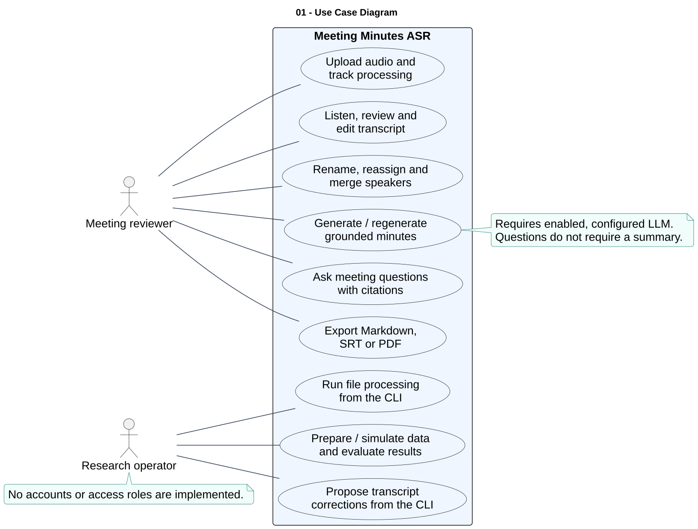

# 01 — Use Case Diagram

**Loại:** UML Use Case. **Phạm vi:** triển khai hiện tại.

Xác định hai nhóm người dùng theo cách sử dụng: người soát biên bản trên web và người vận hành nghiên cứu bằng CLI. Đây là vai trò nghiệp vụ, không phải các quyền được cấp trong ứng dụng.

[Nguồn chỉnh sửa](../diagrams/plantuml/01-use-case-diagram.puml) · [SVG](../diagrams/svg/01-use-case-diagram.svg) · [Danh mục](../README.md)

## Đối chiếu mã nguồn

- [src/meeting_asr/api.py](../../../src/meeting_asr/api.py)
- [src/meeting_asr/cli.py](../../../src/meeting_asr/cli.py)
- [src/meeting_asr/correction.py](../../../src/meeting_asr/correction.py)
- [web/components/MeetingApp.tsx](../../../web/components/MeetingApp.tsx)
