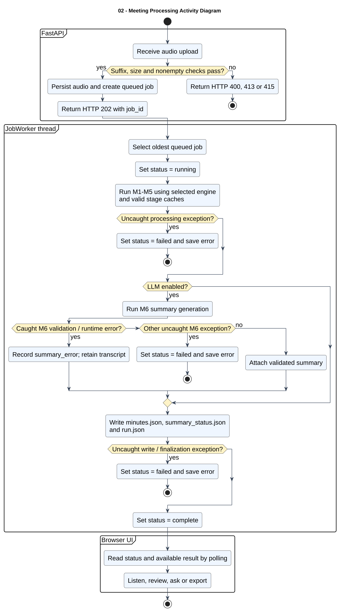

# 02 — Meeting Processing Activity Diagram

**Loại:** UML Activity. **Phạm vi:** triển khai hiện tại.

Mô tả hoạt động từ tiếp nhận file đến xử lý nền và hiển thị kết quả. Lỗi LLM thuộc nhóm được bắt trong pipeline chỉ ghi nhận lỗi tóm tắt; các ngoại lệ khác có thể làm job thất bại.

[Nguồn chỉnh sửa](../diagrams/plantuml/02-activity-meeting-processing.puml) · [SVG](../diagrams/svg/02-activity-meeting-processing.svg) · [Danh mục](../README.md)

Đây là nhánh `kind=pipeline`. Job tạo lại biên bản chỉ chạy M6, được mô tả ở sơ đồ 08 và 14. Các artifact RTTM/transcript được ghi sớm hơn minutes.json. Nhóm M6 được bắt: ValueError, RuntimeError, KeyError, TypeError; không phải mọi Exception.

## Đối chiếu mã nguồn

- [src/meeting_asr/api.py](../../../src/meeting_asr/api.py)
- [src/meeting_asr/jobs.py](../../../src/meeting_asr/jobs.py)
- [src/meeting_asr/pipeline.py](../../../src/meeting_asr/pipeline.py)
