# 03 — System Context Diagram

**Loại:** C4 Level 1. **Phạm vi:** triển khai hiện tại.

Đặt toàn bộ ứng dụng trong một ranh giới và chỉ thể hiện người dùng cùng các hệ thống phụ thuộc bên ngoài. SQLite và filesystem thuộc nội bộ giải pháp, không phải dịch vụ ngoài.

[Nguồn chỉnh sửa](../diagrams/mermaid/03-system-context-diagram.mmd) · [SVG](../diagrams/svg/03-system-context-diagram.svg) · [Danh mục](../README.md)

 C4 được biểu diễn bằng Mermaid flowchart với vai trò Person, Software System, Container và Data Store ghi rõ; đây không phải sơ đồ UML.

## Đối chiếu mã nguồn

- [src/meeting_asr/api.py](../../../src/meeting_asr/api.py)
- [src/meeting_asr/cli.py](../../../src/meeting_asr/cli.py)
- [src/meeting_asr/dicow_runner.py](../../../src/meeting_asr/dicow_runner.py)
- [src/meeting_asr/summarize.py](../../../src/meeting_asr/summarize.py)
