# 04 — Container Diagram

**Loại:** C4 Level 2. **Phạm vi:** triển khai hiện tại.

Thể hiện các ứng dụng và kho dữ liệu ở mức C4 container. Container ở C4 là đơn vị ứng dụng hoặc kho dữ liệu; không đồng nghĩa với một Docker service. Worker và subprocess DiCoW được triển khai bên trong backend, không phải dịch vụ mạng độc lập.

[Nguồn chỉnh sửa](../diagrams/mermaid/04-container-diagram.mmd) · [SVG](../diagrams/svg/04-container-diagram.svg) · [Danh mục](../README.md)

Phạm vi sơ đồ là nội bộ; phụ thuộc Hugging Face/LLM xem sơ đồ 03, các lời gọi chi tiết xem sơ đồ 05. Local theo web/.env.example gọi trực tiếp API :8000; Compose đặt NEXT_PUBLIC_API_URL rỗng để dùng rewrite cùng origin. C4 được biểu diễn bằng Mermaid flowchart với vai trò Person, Software System, Container và Data Store ghi rõ; đây không phải sơ đồ UML.

## Đối chiếu mã nguồn

- [compose.yaml](../../../compose.yaml)
- [web/next.config.ts](../../../web/next.config.ts)
- [web/lib/api.ts](../../../web/lib/api.ts)
- [src/meeting_asr/api.py](../../../src/meeting_asr/api.py)
- [src/meeting_asr/jobs.py](../../../src/meeting_asr/jobs.py)
- [src/meeting_asr/cli.py](../../../src/meeting_asr/cli.py)
