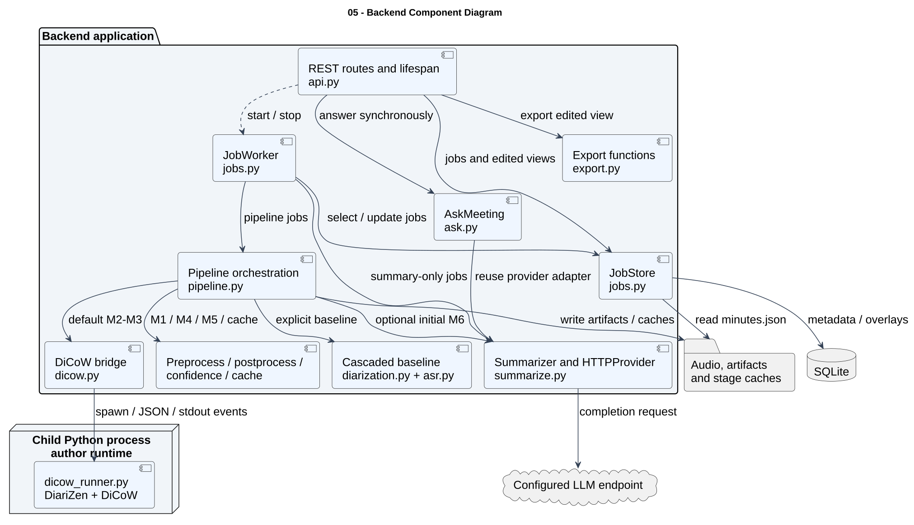

# 05 — Backend Component Diagram

**Loại:** UML Component. **Phạm vi:** triển khai hiện tại.

Phân chia trách nhiệm backend và hướng gọi giữa các thành phần. AskMeeting chạy trong request API; JobWorker chỉ điều phối pipeline hoặc tạo lại biên bản. DiCoW runner là tiến trình con trong cùng môi trường triển khai backend.

[Nguồn chỉnh sửa](../diagrams/plantuml/05-component-backend.puml) · [SVG](../diagrams/svg/05-component-backend.svg) · [Danh mục](../README.md)

Các mũi tên nét đứt biểu thị phụ thuộc/lifecycle; mũi tên liền có nhãn biểu thị tương tác thực thi. SQLite và filesystem là tài nguyên; chi tiết triển khai xem 12. Summarizer không được gọi qua API HTTP nội bộ riêng.

## Đối chiếu mã nguồn

- [src/meeting_asr/api.py](../../../src/meeting_asr/api.py)
- [src/meeting_asr/jobs.py](../../../src/meeting_asr/jobs.py)
- [src/meeting_asr/pipeline.py](../../../src/meeting_asr/pipeline.py)
- [src/meeting_asr/ask.py](../../../src/meeting_asr/ask.py)
- [src/meeting_asr/summarize.py](../../../src/meeting_asr/summarize.py)
- [src/meeting_asr/dicow.py](../../../src/meeting_asr/dicow.py)
