# 06 — Meeting Processing Data Flow Diagram

**Loại:** DFD Level 1. **Phạm vi:** triển khai hiện tại.

Phân rã dòng dữ liệu của pipeline upload thành ba tiến trình và hai kho lưu trữ. Mỗi mũi tên mang tên dữ liệu; sơ đồ không dùng mũi tên để mô tả điều kiện hoặc thứ tự điều khiển.

[Nguồn chỉnh sửa](../diagrams/mermaid/06-data-flow-diagram.mmd) · [SVG](../diagrams/svg/06-data-flow-diagram.svg) · [Danh mục](../README.md)

Ký pháp DFD giản lược: chữ nhật = tác nhân ngoài; khối bo tròn = tiến trình; hình trụ = kho dữ liệu. Phạm vi là job pipeline ban đầu; review, export, regenerate và Q&A xem sơ đồ 08, 09, 15. Cache vật lý được lược khỏi DFD logic và trình bày ở 04/12. LLM là tùy chọn và chỉ nhận văn bản trong luồng này. Kết quả được đọc qua API như sơ đồ 07; không có luồng trực tiếp từ kho dữ liệu tới người dùng.

## Đối chiếu mã nguồn

- [src/meeting_asr/api.py](../../../src/meeting_asr/api.py)
- [src/meeting_asr/jobs.py](../../../src/meeting_asr/jobs.py)
- [src/meeting_asr/pipeline.py](../../../src/meeting_asr/pipeline.py)
- [src/meeting_asr/ask.py](../../../src/meeting_asr/ask.py)
- [src/meeting_asr/export.py](../../../src/meeting_asr/export.py)
