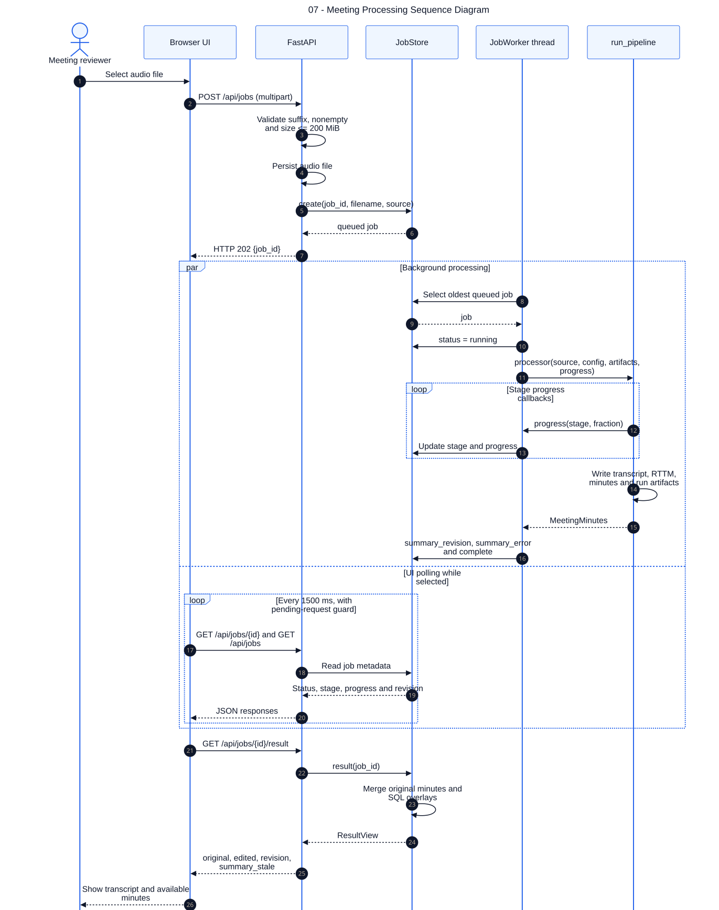

# 07 — Meeting Processing Sequence Diagram

**Loại:** UML Sequence. **Phạm vi:** triển khai hiện tại.

Thể hiện upload trả về trước khi xử lý AI kết thúc và UI poll song song với worker. Mọi phản hồi HTTP đều đi từ backend qua lớp API; SQLite không trả kết quả trực tiếp cho trình duyệt.

[Nguồn chỉnh sửa](../diagrams/mermaid/07-sequence-meeting-processing.mmd) · [SVG](../diagrams/svg/07-sequence-meeting-processing.svg) · [Danh mục](../README.md)

Sơ đồ mô tả nhánh thành công. UI tiếp tục poll khi job đang được chọn; chỉ nạp lại result ở trạng thái complete/failed khi revision, status hoặc cờ refresh thay đổi. Ngoại lệ và retry xem sơ đồ 14.

## Đối chiếu mã nguồn

- [src/meeting_asr/api.py](../../../src/meeting_asr/api.py)
- [src/meeting_asr/jobs.py](../../../src/meeting_asr/jobs.py)
- [src/meeting_asr/pipeline.py](../../../src/meeting_asr/pipeline.py)
- [web/components/MeetingApp.tsx](../../../web/components/MeetingApp.tsx)
