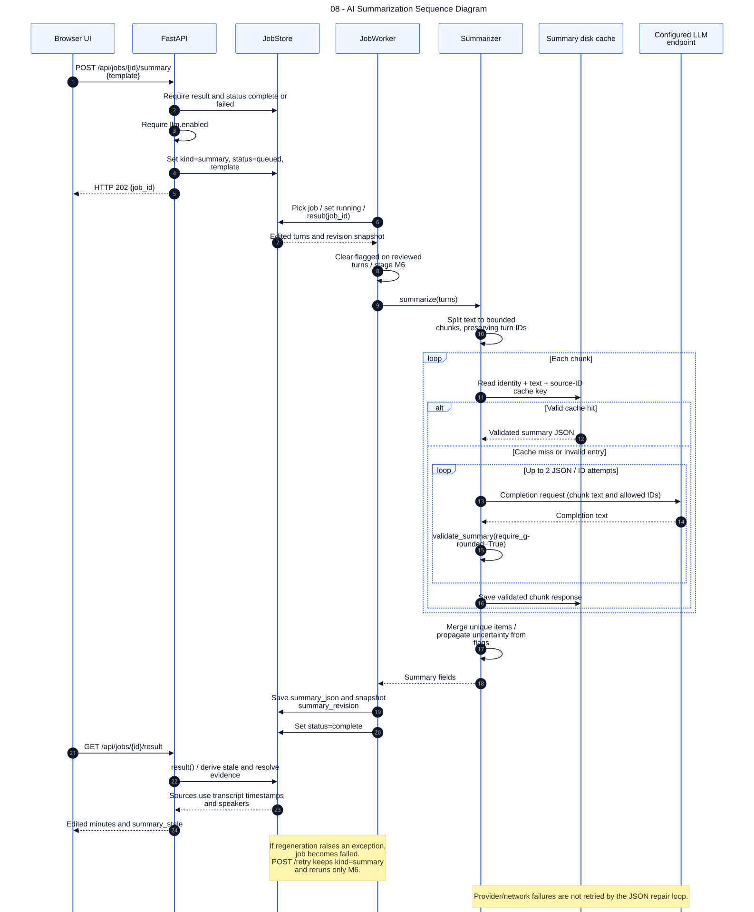

# 08 — AI Summarization Sequence Diagram

**Loại:** UML Sequence. **Phạm vi:** triển khai hiện tại.

Mô tả tạo lại biên bản trên snapshot transcript đã sửa. Tóm tắt dài được chia phần, kiểm tra JSON và ID nguồn từng phần rồi ghép kết quả xác định; không có lời gọi LLM thứ hai để tóm tắt gộp.

[Nguồn chỉnh sửa](../diagrams/mermaid/08-sequence-ai-summarization.mmd) · [SVG](../diagrams/svg/08-sequence-ai-summarization.svg) · [Danh mục](../README.md)

Trong lần chạy pipeline đầu, M6 gọi cùng Summarizer nhưng ghi nội dung vào minutes.json; nhóm lỗi được bắt ghi summary_status.json và worker vẫn có thể complete. Regenerate lưu vào jobs.summary_json, không ghi đè minutes.json và không chạy lại ASR. Template: project, standup, customer.

## Đối chiếu mã nguồn

- [src/meeting_asr/api.py](../../../src/meeting_asr/api.py)
- [src/meeting_asr/jobs.py](../../../src/meeting_asr/jobs.py)
- [src/meeting_asr/summarize.py](../../../src/meeting_asr/summarize.py)
- [src/meeting_asr/pipeline.py](../../../src/meeting_asr/pipeline.py)
