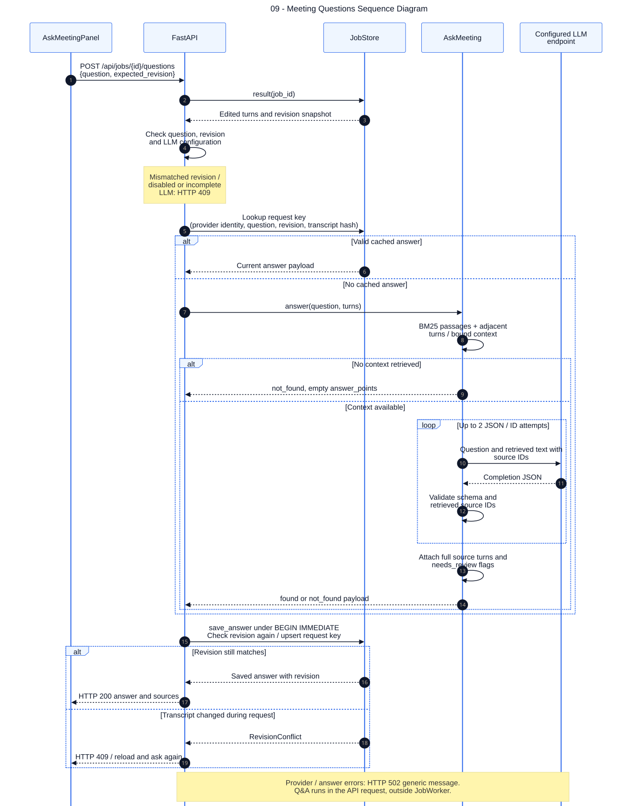

# 09 — Meeting Questions Sequence Diagram

> **Cần cập nhật:** sơ đồ lập theo snapshot 30/10/2026, trước khi giao diện được thiết kế lại (PR #4). Tên component web hiện tại: xem [web/components](../../../web/components).

**Loại:** UML Sequence. **Phạm vi:** triển khai hiện tại.

Mô tả hỏi đáp từ transcript đã sửa, có cache câu trả lời và kiểm tra revision cả trước khi gọi model lẫn lúc ghi kết quả. Truy xuất dùng BM25 và lượt lân cận; không có vector database.

[Nguồn chỉnh sửa](../diagrams/mermaid/09-sequence-meeting-questions.mmd) · [SVG](../diagrams/svg/09-sequence-meeting-questions.svg) · [Danh mục](../README.md)

GET /questions trả tối đa 20 câu gần nhất; các câu cũ vẫn được lưu trong DB và được gắn stale khi revision khác hiện tại. Câu hỏi tối đa 1000 ký tự. Cache answer nằm ở ask_answers, không phải một cache câu trả lời filesystem đang hoạt động.

## Đối chiếu mã nguồn

- [src/meeting_asr/api.py](../../../src/meeting_asr/api.py)
- [src/meeting_asr/ask.py](../../../src/meeting_asr/ask.py)
- [src/meeting_asr/jobs.py](../../../src/meeting_asr/jobs.py)
- `web/components/AskMeetingPanel.tsx` (đã đổi tên hoặc thay thế)
