# 10 — Entity Relationship Diagram

**Loại:** Logical ERD over Physical SQLite Tables. **Phạm vi:** triển khai hiện tại.

Mô tả đúng sáu bảng SQLite và các khóa chính/khóa duy nhất thực tế. Đường quan hệ theo job_id là quan hệ logic do ứng dụng quản lý; DDL không khai báo FOREIGN KEY. Artifact và lượt nói trong JSON không phải bảng SQL.

[Nguồn chỉnh sửa](../diagrams/mermaid/10-entity-relationship-diagram.mmd) · [SVG](../diagrams/svg/10-entity-relationship-diagram.svg) · [Danh mục](../README.md)

Các cột INTEGER/TEXT phản ánh declared type trong SQLite. `UNIQUE(job_id, request_key)` là khóa duy nhất ghép, không phải từng cột độc lập. `speakers` chỉ lưu tên tùy chỉnh nên không phải danh mục đầy đủ của mọi speaker trong transcript.

## Đối chiếu mã nguồn

- [src/meeting_asr/jobs.py](../../../src/meeting_asr/jobs.py)
- [src/meeting_asr/models.py](../../../src/meeting_asr/models.py)
- [src/meeting_asr/io.py](../../../src/meeting_asr/io.py)
