# 11 — AI Processing Pipeline

**Loại:** Processing Flowchart. **Phạm vi:** triển khai hiện tại.

Thể hiện dữ liệu đi qua các bước M1–M6, hai engine đã triển khai và đầu ra chính. DiCoW dùng audio đầy đủ với target masks; chỉ baseline mới cắt audio theo timeline diarization. AskMeeting là luồng theo yêu cầu riêng sau khi có transcript.

[Nguồn chỉnh sửa](../diagrams/mermaid/11-ai-processing-pipeline.mmd) · [SVG](../diagrams/svg/11-ai-processing-pipeline.svg) · [Danh mục](../README.md)

Oracle RTTM có thể thay M2 ở cả hai engine khi gọi pipeline/CLI; API upload không cung cấp tham số oracle. Cache hợp lệ có thể bỏ qua model work. DiCoW không cung cấp token logprob/cluster margin; confidence chưa hiệu chỉnh, target_coverage=0.20 là ngân sách thời lượng lượt nói dự đoán, không đảm bảo chọn đủ 20%.

## Đối chiếu mã nguồn

- [configs/default.yaml](../../../configs/default.yaml)
- [configs/baseline-phowhisper.yaml](../../../configs/baseline-phowhisper.yaml)
- [configs/improved-ecapa.yaml](../../../configs/improved-ecapa.yaml)
- [src/meeting_asr/pipeline.py](../../../src/meeting_asr/pipeline.py)
- [src/meeting_asr/dicow_runner.py](../../../src/meeting_asr/dicow_runner.py)
- [src/meeting_asr/confidence.py](../../../src/meeting_asr/confidence.py)
