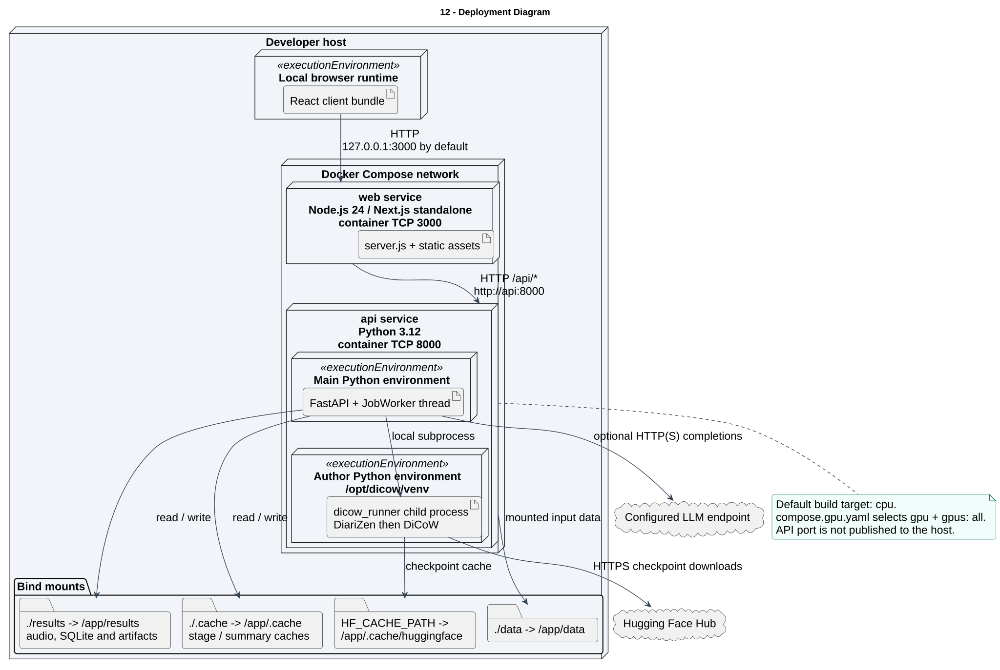

# 12 — Deployment Diagram

**Loại:** UML Deployment. **Phạm vi:** triển khai hiện tại.

Mô tả topology trong compose.yaml: hai service web và api, chỉ web được publish mặc định trên loopback. Python runtime tác giả và tiến trình DiCoW nằm trong container api; SQLite là tệp trên volume results, không có container DB riêng.

[Nguồn chỉnh sửa](../diagrams/plantuml/12-deployment-diagram.puml) · [SVG](../diagrams/svg/12-deployment-diagram.svg) · [Danh mục](../README.md)

Compose bind mặc định 127.0.0.1:${WEB_PORT:-3000}; WEB_HOST có thể thay đổi. Không có TLS terminator trong Compose. Local development dùng hai process, web :3000 và API :8000; web/.env.example đặt URL gọi trực tiếp. Health chỉ đọc cấu hình, không kiểm chứng đã load model. Đây là topology từ cấu hình, không phải bằng chứng chạy Docker trong đợt audit này.

## Đối chiếu mã nguồn

- [compose.yaml](../../../compose.yaml)
- [compose.gpu.yaml](../../../compose.gpu.yaml)
- [Dockerfile](../../../Dockerfile)
- [web/Dockerfile](../../../web/Dockerfile)
- [web/next.config.ts](../../../web/next.config.ts)
- [scripts/setup_dicow.py](../../../scripts/setup_dicow.py)
