# 13 — Domain Model Class Diagram

**Loại:** UML Class. **Phạm vi:** triển khai hiện tại.

Mô tả các dataclass trao đổi dữ liệu trong pipeline, không phải ORM hay bảng SQL. Dùng quan hệ kết hợp để tránh hàm ý sở hữu vòng đời độc quyền, vì Utterance có thể được tham chiếu đồng thời trong transcript và turn.

[Nguồn chỉnh sửa](../diagrams/mermaid/13-class-domain-model.mmd) · [SVG](../diagrams/svg/13-class-domain-model.svg) · [Danh mục](../README.md)

`duration` của AudioBundle/Segment và `num_speakers` của TranscriptDocument là property tính toán. `DiarizationResult` nằm trong diarization.py; các lớp còn lại nằm trong models.py. Optional biểu thị giá trị có thể null.

## Đối chiếu mã nguồn

- [src/meeting_asr/models.py](../../../src/meeting_asr/models.py)
- [src/meeting_asr/diarization.py](../../../src/meeting_asr/diarization.py)
- [src/meeting_asr/postprocess.py](../../../src/meeting_asr/postprocess.py)
- [src/meeting_asr/io.py](../../../src/meeting_asr/io.py)
