# 14 — Job Lifecycle State Machine

**Loại:** UML State Machine. **Phạm vi:** triển khai hiện tại.

Mô tả chính xác bốn trạng thái job và các đường quay lại hàng đợi. status và stage là hai trường khác nhau; summary_stale là giá trị suy ra, không phải trạng thái job.

[Nguồn chỉnh sửa](../diagrams/mermaid/14-state-job-lifecycle.mmd) · [SVG](../diagrams/svg/14-state-job-lifecycle.svg) · [Danh mục](../README.md)

POST /retry chấp nhận bất kỳ job failed, giữ nguyên kind; vì vậy job summary thất bại được thử lại chỉ M6. POST /summary chấp nhận complete/failed nếu đã có minutes.json và llm.enabled. Worker startup đưa running về queued; không có API cancel, lease hay tự retry/backoff.

## Đối chiếu mã nguồn

- [src/meeting_asr/jobs.py](../../../src/meeting_asr/jobs.py)
- [src/meeting_asr/api.py](../../../src/meeting_asr/api.py)
- [src/meeting_asr/pipeline.py](../../../src/meeting_asr/pipeline.py)
