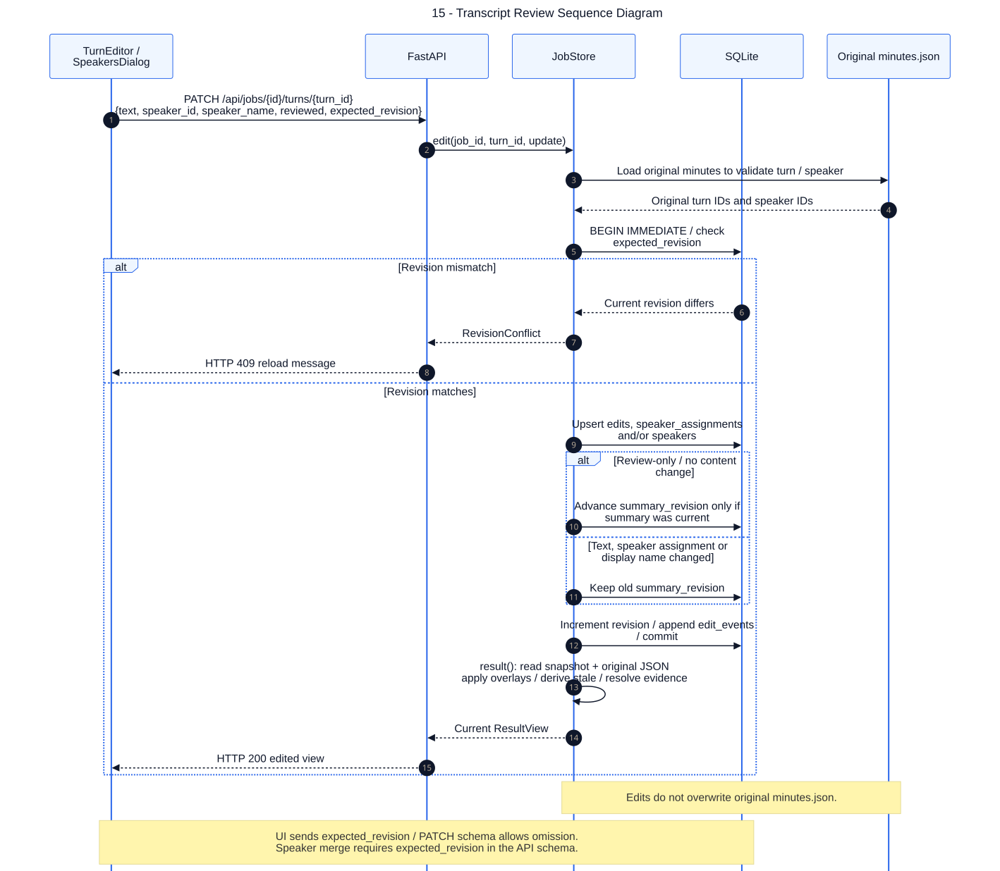

# 15 — Transcript Review Sequence Diagram

**Loại:** UML Sequence. **Phạm vi:** triển khai hiện tại.

Mô tả chỉnh sửa có optimistic concurrency và cách tạo result từ dữ liệu gốc cộng overlay. Chỉ đánh dấu đã soát vẫn tăng revision, nhưng có thể giữ biên bản hiện hành không stale; câu trả lời cũ vẫn stale theo revision.

[Nguồn chỉnh sửa](../diagrams/mermaid/15-sequence-transcript-review.mmd) · [SVG](../diagrams/svg/15-sequence-transcript-review.svg) · [Danh mục](../README.md)

Merge speaker dùng POST /speakers/merge: cập nhật assignments của các turn đang thuộc source, tăng revision và lưu speaker_merge event. Nội dung transcript thay đổi không tự tạo lại biên bản. Export Markdown/PDF bỏ summary stale và ghi chú cần tạo lại; SRT luôn lấy edited.turns.

## Đối chiếu mã nguồn

- [web/components/ReviewControls.tsx](../../../web/components/ReviewControls.tsx)
- [src/meeting_asr/api.py](../../../src/meeting_asr/api.py)
- [src/meeting_asr/jobs.py](../../../src/meeting_asr/jobs.py)
- [src/meeting_asr/export.py](../../../src/meeting_asr/export.py)
