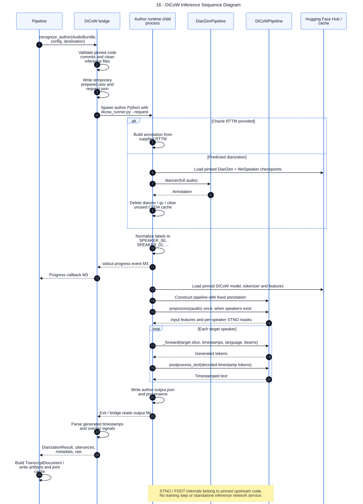

# 16 — DiCoW Inference Sequence Diagram

**Loại:** UML Sequence. **Phạm vi:** triển khai hiện tại.

Làm rõ giao thức tiến trình con và thứ tự inference ở trường hợp cache miss. Audio được chuẩn bị một lần trước vòng lặp target speaker; bridge trả diarization, utterances, metadata và raw result, sau đó pipeline mới tạo TranscriptDocument.

[Nguồn chỉnh sửa](../diagrams/mermaid/16-sequence-dicow-inference.mmd) · [SVG](../diagrams/svg/16-sequence-dicow-inference.svg) · [Danh mục](../README.md)

CPU dùng float32, CUDA dùng float16. Runtime kiểm tra mt_num_speakers=1 và không use_enrollments. Nội bộ thuật toán upstream không được chạy lại trong đợt audit; sơ đồ chỉ khẳng định các lời gọi được quan sát trong adapter. DiCoW cache hit bỏ qua toàn bộ subprocess.

## Đối chiếu mã nguồn

- [src/meeting_asr/dicow.py](../../../src/meeting_asr/dicow.py)
- [src/meeting_asr/dicow_runner.py](../../../src/meeting_asr/dicow_runner.py)
- [src/meeting_asr/pipeline.py](../../../src/meeting_asr/pipeline.py)
- [scripts/setup_dicow.py](../../../scripts/setup_dicow.py)
