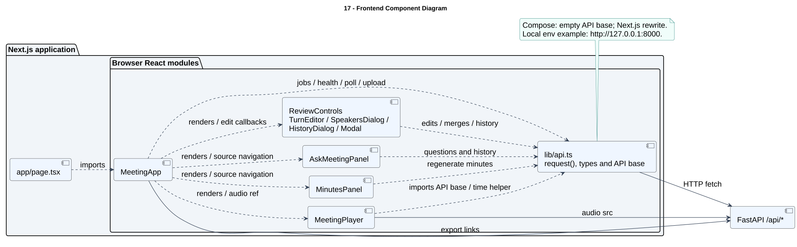

# 17 — Frontend Component Diagram

> **Cần cập nhật:** sơ đồ lập theo snapshot 30/10/2026, trước khi giao diện được thiết kế lại (PR #4). Tên component web hiện tại: xem [web/components](../../../web/components).

**Loại:** UML Component. **Phạm vi:** triển khai hiện tại.

Thể hiện các module giao diện thực sự được import và cách chúng dùng HTTP client hoặc đường dẫn audio/export. Các hộp đại diện module React/TypeScript, không phải service được triển khai riêng.

[Nguồn chỉnh sửa](../diagrams/plantuml/17-component-frontend.puml) · [SVG](../diagrams/svg/17-component-frontend.svg) · [Danh mục](../README.md)

## Đối chiếu mã nguồn

- [web/app/page.tsx](../../../web/app/page.tsx)
- [web/components/MeetingApp.tsx](../../../web/components/MeetingApp.tsx)
- `web/components/MeetingPlayer.tsx` (đã đổi tên hoặc thay thế)
- `web/components/MinutesPanel.tsx` (đã đổi tên hoặc thay thế)
- `web/components/AskMeetingPanel.tsx` (đã đổi tên hoặc thay thế)
- [web/components/ReviewControls.tsx](../../../web/components/ReviewControls.tsx)
- [web/lib/api.ts](../../../web/lib/api.ts)
